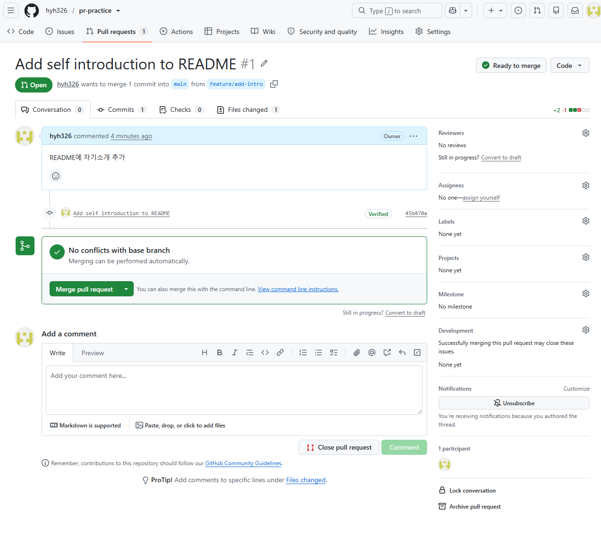
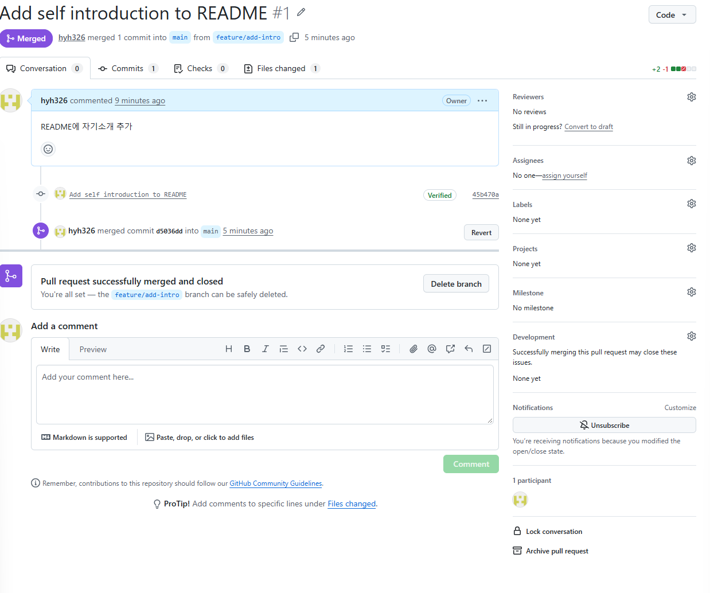
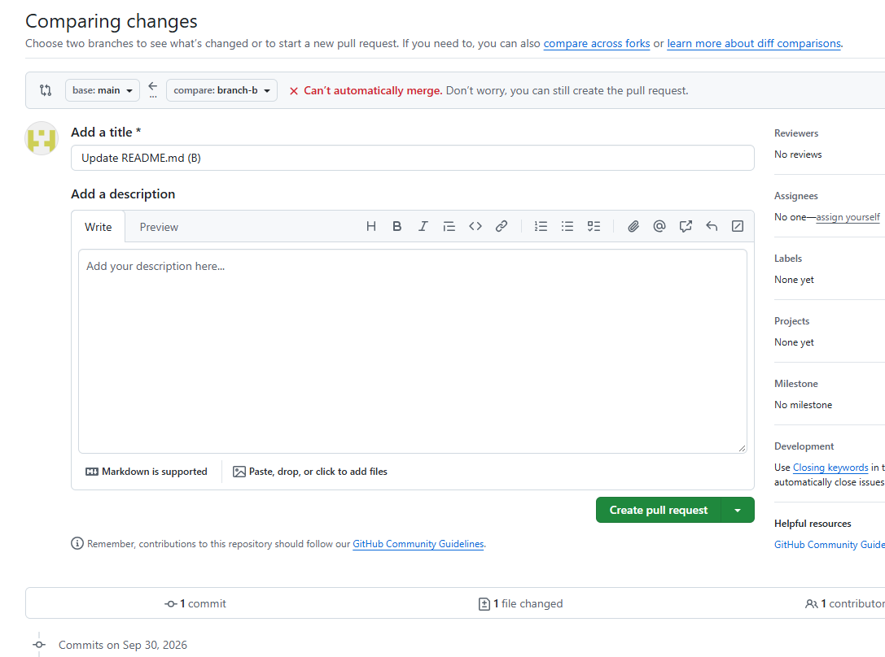
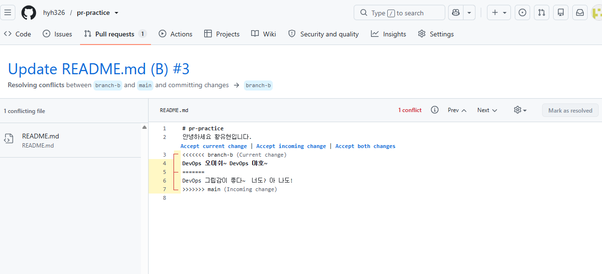
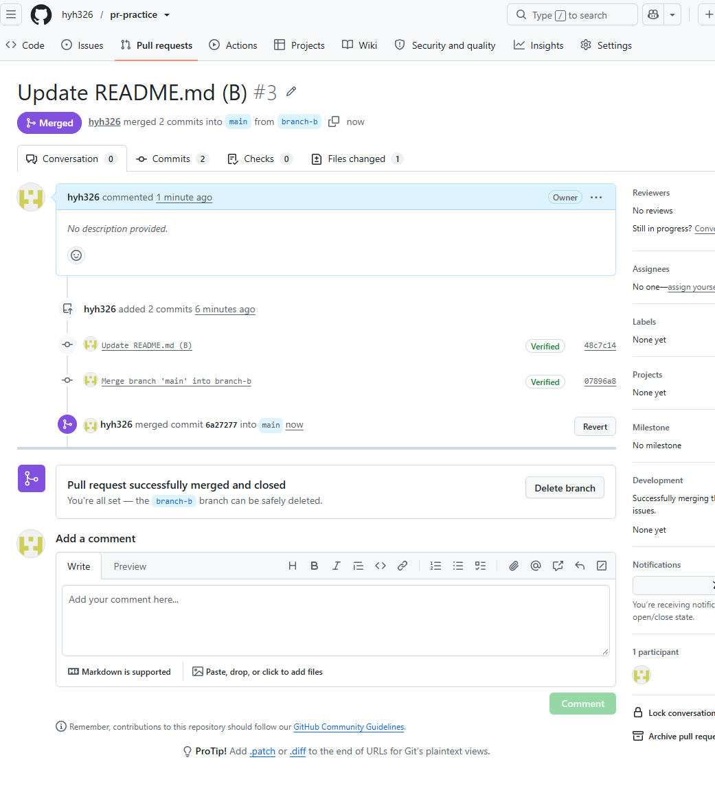

# 4주차 - GitHub Pull Request와 Conflict 해결

4주차(자동화와 협업) 내용 중 Pull Request 생성, Merge, Conflict 해결을 `pr-practice` 리포지터리에서 실습했다.

- 실습 리포지터리: https://github.com/hyh326/pr-practice
- 실습 방식: GitHub 웹 UI에서 브랜치 생성, 파일 수정, PR 생성, Merge

## 1. 한 일

### Part 1. PR 생성과 Merge

1. main에서 `feature/add-intro` 브랜치를 만들고 README.md에 자기소개 문장을 추가해 커밋했다.
2. base는 main, compare는 `feature/add-intro`로 PR #1을 만들었다. 생성 직후 `No conflicts with base branch`가 표시되어 바로 Merge할 수 있는 상태였다.
3. `Merge pull request` → `Confirm merge`로 main에 Merge했다. 상태가 Merged(보라색)로 바뀌었다.

### Part 2. Conflict 발생과 해결

Conflict는 서로 다른 브랜치가 같은 파일의 같은 위치를 다르게 수정했을 때 생긴다. 이를 직접 만들어 보기 위해 main에서 `branch-a`, `branch-b`를 만들고 README.md의 3번째 줄에 서로 다른 문장을 추가했다.

1. `branch-a`의 PR #2를 먼저 Merge했다. main에 branch-a의 3번째 줄이 반영되었다.
2. 이어서 `branch-b`의 PR #3을 만들자 `Can't automatically merge` 경고가 나왔다. main에 이미 들어간 branch-a의 수정과 같은 위치가 겹쳤기 때문이다.
3. `Resolve conflicts` 화면에서 충돌 마커를 확인했다. 위쪽 마커와 `=======` 사이가 branch-b의 내용이고, `=======`와 아래쪽 마커 사이가 main(branch-a)의 내용이다.
4. `Accept both changes`로 두 문장을 모두 남기고 마커를 제거한 뒤 `Mark as resolved` → `Commit merge`를 눌렀다.
5. 충돌 해결 커밋이 추가되어 PR #3에는 커밋이 2개 들어갔고, Merge로 마무리했다.

## 2. 알게 된 점

- 브랜치 분리 → 수정 → PR → Merge 순서로 main을 직접 건드리지 않고 변경을 합칠 수 있다.
- 같은 파일의 같은 위치를 두 브랜치가 다르게 고치면 Conflict가 난다. 먼저 Merge된 쪽이 main에 반영되고, 나중 PR에서 충돌이 감지된다.
- Conflict는 current, incoming, both 중 상황에 맞게 고르거나 직접 편집해서 해결하고, 해결 커밋을 남긴 뒤 Merge한다.
