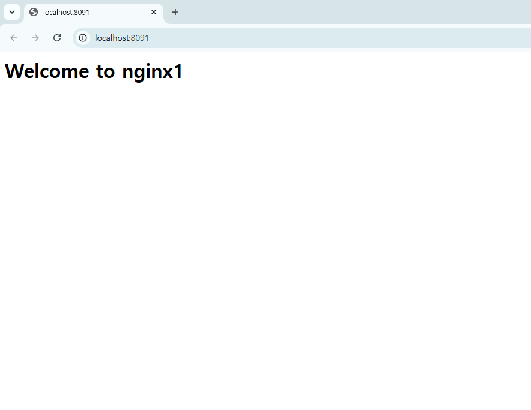
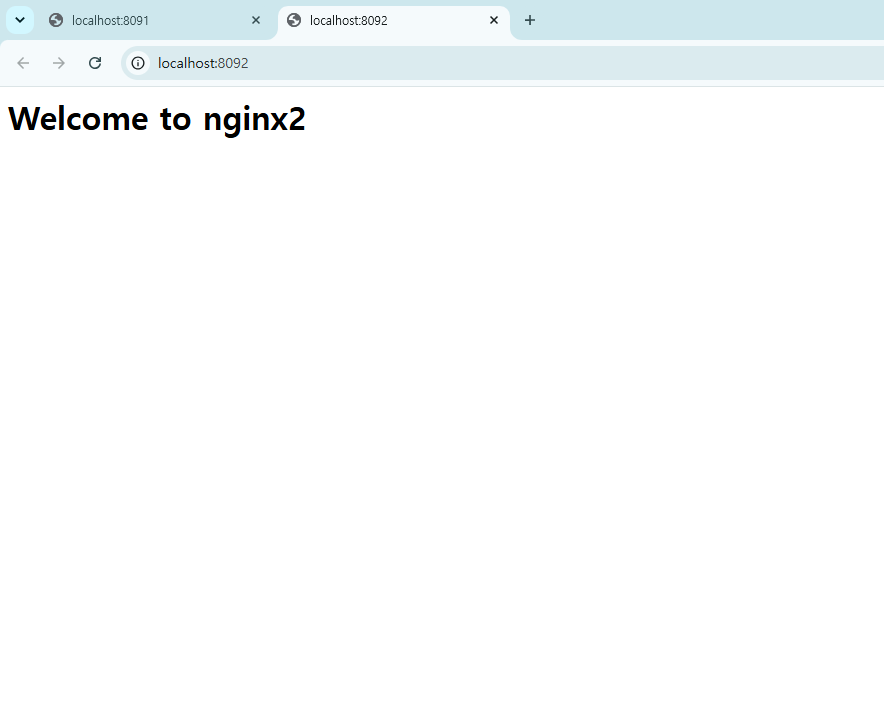
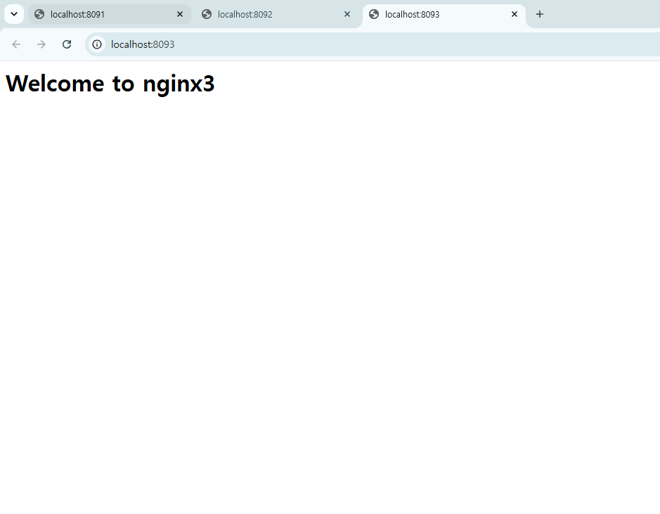
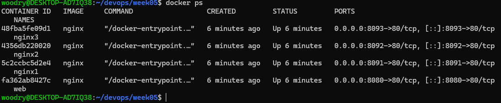

# 5주차 - Docker와 GitHub Issue

Docker 기본 명령어와 컨테이너 실습을 GitHub Issue로 관리했다. Issue #1에서 완료 조건을 정하고, 브랜치에서 작업한 뒤 Pull Request로 Merge했다.

- 이슈: [#1 5주차 Docker 실행 환경 확인 및 nginx 실행](https://github.com/hyh326/devops/issues/1)
- 작업 브랜치: `docs/issue-1-docker-start`

## 1. 작업 흐름

Issue → Branch → 기록 → Commit/Push → PR → Merge → Issue Close

1. Issue #1에 목표와 완료 조건(체크박스)을 적었다.
2. `git switch -c docs/issue-1-docker-start`로 작업 브랜치를 만들었다.
3. Docker 실습 결과를 이 폴더에 파일로 저장하고 README에 기록했다.
4. 커밋, 푸시한 뒤 PR 본문에 `Close #1`을 적어 만들었다.
5. PR을 squash Merge하면 Issue #1이 자동으로 닫힌다.

## 2. Docker 실행 환경 확인

| 명령어 | 결과 파일 |
|---|---|
| `docker --version` | [docker-version.txt](./docker-version.txt) |
| `docker info` | [docker-info.txt](./docker-info.txt) |
| `docker run --rm hello-world` | [docker-run-hello-world.txt](./docker-run-hello-world.txt) |

`docker --version`은 Docker version 29.8.2로 나왔고, hello-world는 `Hello from Docker!` 메시지가 출력되어 정상 동작을 확인했다.

## 3. nginx 컨테이너 실행

```bash
docker run -d -p 8080:80 --name web nginx
curl -I http://localhost:8080 > curl-result.txt
docker ps > docker-ps.txt
```

- `-d`는 백그라운드 실행, `-p 8080:80`은 내 컴퓨터의 8080 포트를 컨테이너의 80 포트에 연결한다는 뜻이다.
- `curl -I`로 응답 헤더만 받아서 `HTTP/1.1 200 OK`를 확인했다. ([curl-result.txt](./curl-result.txt))
- `docker ps`에서 `web` 컨테이너가 `Up` 상태이고 포트가 `0.0.0.0:8080->80/tcp`로 연결된 것을 확인했다. ([docker-ps.txt](./docker-ps.txt))

## 4. 혼자서 해보기

nginx 컨테이너 3개를 포트 8091, 8092, 8093으로 `nginx1`, `nginx2`, `nginx3`이라는 이름으로 실행하고, 각각 `index.html`을 바꿔서 서로 구분되게 만들었다.

```bash
for i in 1 2 3; do
  docker run -d -p 809$i:80 --name nginx$i nginx
done
for i in 1 2 3; do
  docker exec nginx$i sh -c "echo '<h1>Welcome to nginx$i</h1>' > /usr/share/nginx/html/index.html"
done
```

수업에서는 `docker exec -it`로 컨테이너에 들어가서 직접 수정했는데, 나는 `exec`에 명령을 바로 넘겨서 한 줄로 수정했다. 결과는 같다.

`curl`로 세 페이지를 확인한 결과는 아래와 같다. ([curl-nginx.txt](./curl-nginx.txt))

~~~
== nginx1 (8091)
<h1>Welcome to nginx1</h1>
== nginx2 (8092)
<h1>Welcome to nginx2</h1>
== nginx3 (8093)
<h1>Welcome to nginx3</h1>
~~~

브라우저에서 확인한 화면이다.







`docker ps` 결과다. `web`과 `nginx1~3`이 모두 실행 중이다. ([docker-ps-3.txt](./docker-ps-3.txt))



## 5. 정리

실습이 끝난 뒤 `docker rm -f web nginx1 nginx2 nginx3`으로 컨테이너를 모두 지웠다. `-f`는 실행 중인 컨테이너도 강제로 지운다는 옵션이다. 정리 후 `docker ps -a`에는 이번 실습에서 만든 컨테이너가 남아 있지 않고, 이전 주차에 만든 종료된 컨테이너 2개(`custom`, `stoic_bassi`)만 남아 있다. ([docker-ps-after.txt](./docker-ps-after.txt))

## 6. 알게 된 점

- 컨테이너를 지우면 그 안에서 수정한 내용도 함께 사라진다. 그래서 nginx 페이지를 바꾼 것도 컨테이너를 지우면 원래대로 돌아간다.
- 같은 이미지(nginx)로 컨테이너를 여러 개 띄워도 포트와 이름만 다르면 서로 독립적으로 실행된다.
- Docker 실습도 Issue로 완료 조건을 정하고 체크하면서 진행하니 무엇을 했는지 기록이 남는다.
