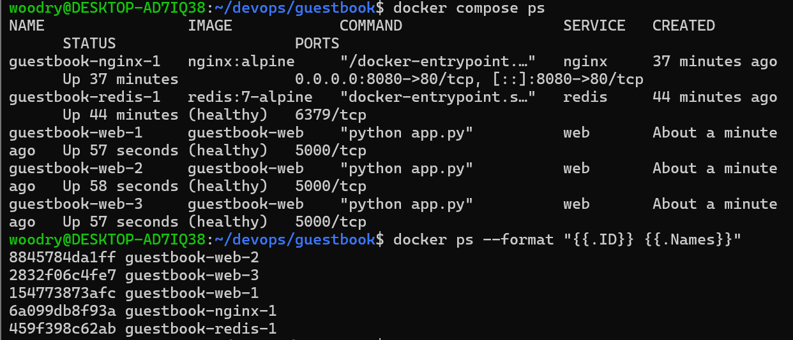

# week07 기록

## 1. docker compose ps 결과

- nginx 1개, redis 1개, web 3개(guestbook-web-1~3)가 실행 중
- web, redis는 healthy: healthcheck(web은 /readyz 응답, redis는 ping)를 통과했다는 뜻
- nginx는 healthcheck를 설정하지 않아서 healthy 표시 없이 Up만 나옴

## 2. scale 후 호스트명 변화
`docker compose up -d --scale web=3`으로 web을 3개로 늘린 뒤 http://localhost:8080 을 새로고침하며 확인함

| 컨테이너 | 컨테이너 ID | 브라우저의 Pod/Host |
|---|---|---|
| guestbook-web-1 | 154773873afc | 154773873afc |
| guestbook-web-2 | 8845784da1ff | 8845784da1ff |
| guestbook-web-3 | 2832f06c4fe7 | 2832f06c4fe7 |

- 호스트명이 바뀌는 이유: 같은 주소(8080)로 접속해도 nginx가 요청을 web 3개에 나눠서 보내기 때문. 호스트명은 각 컨테이너의 ID와 같음
- 글과 방문 횟수가 이어지는 이유: web 3개가 redis 하나를 같이 쓰기 때문 (방문 25 → 26 → 27회로 이어짐)

## 3. down 후 up vs down -v 후 up
- `docker compose down` 후 up: 컨테이너와 네트워크는 지워지지만 볼륨(redis-data)은 남아서 데이터가 그대로 유지됨
- `docker compose down -v` 후 up: 볼륨까지 삭제되어 redis가 빈 상태로 시작함
- 차이가 나는 이유: 컨테이너는 일회용이고 데이터는 볼륨에 저장되는데, -v가 그 볼륨을 같이 지우기 때문

## 4. .env를 Git에 올리지 않는 이유
- 실제 비밀번호(REDIS_PASSWORD)가 들어 있어서, 올리면 저장소를 보는 사람 누구나 비밀번호를 알 수 있음
- 한 번 커밋하면 나중에 지워도 기록에 남기 때문에 처음부터 .gitignore로 제외함
- 대신 변수 이름만 적은 .env.example을 올려서, 다른 사람이 자기 .env를 만들 수 있게 함
