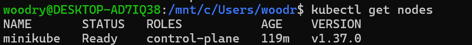
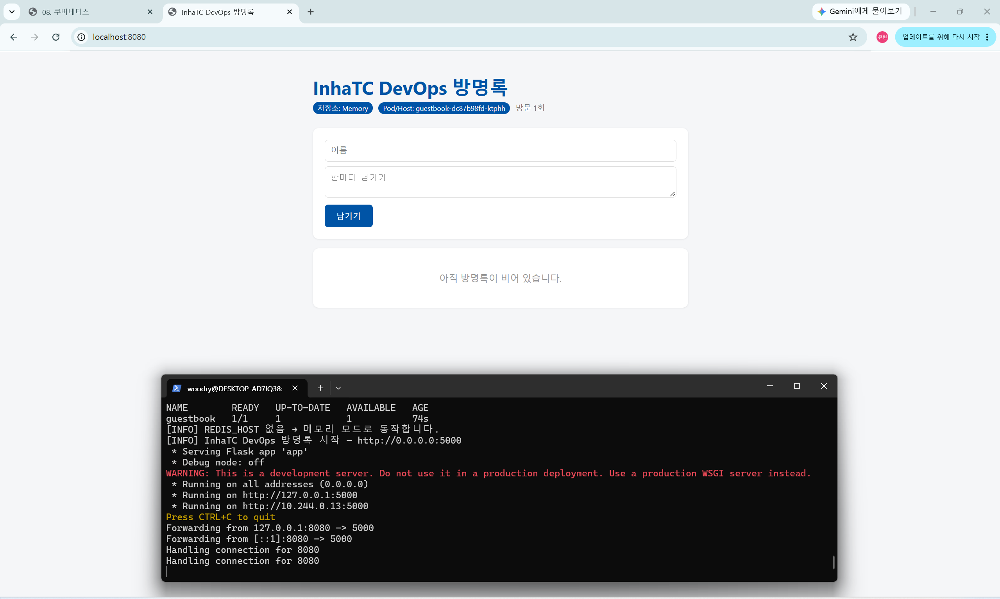
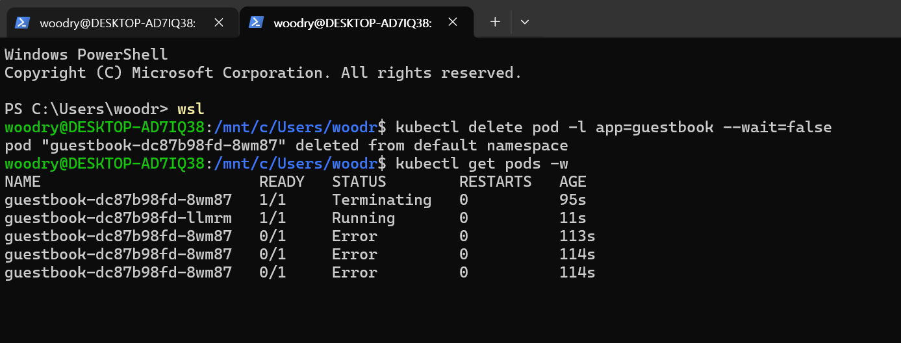

# week09 기록 (쿠버네티스 첫 배포)

사용한 도구: minikube (`--driver=docker`), kubectl v1.37.2 (kind는 설치만 해 봄)

## 1. 설치와 클러스터 확인

- minikube 노드 1개가 `Ready`, ROLES는 `control-plane`, 버전 v1.37.0
- kubectl은 리모컨, minikube는 노트북 안의 TV(클러스터). 둘 다 있어야 동작함. kubectl만 있으면 `connection refused`
- `minikube start --driver=docker`: 도커 컨테이너 하나(minikube)를 서버 1대(노드)처럼 씀. 그래서 Docker Desktop이 켜져 있어야 함
- kind도 설치해 봄 (`kind create cluster --name devops`). 만든 직후에는 `NotReady`였고 잠시 뒤 `Ready`가 됨. 실습은 minikube로 진행
- kubectl이 어느 클러스터에 말하는지는 context가 정함. kind를 만들면 context가 `kind-devops`로 바뀌어서 `kubectl config use-context minikube`로 되돌림
- 확인 습관: `kubectl config current-context` (어느 클러스터인지 먼저 보기)

## 2. 왜 쿠버네티스인가
- `docker run`은 컨테이너 개별 실행, compose는 컨테이너 여러 개를 컴퓨터 1대 안에서만, 쿠버네티스는 여러 대에 걸쳐 자동으로 관리
- compose에 없는 것: 서버가 고장 나면 다른 서버로 옮기기, 여러 서버에 나눠 띄우기, 무중단 배포, 트래픽에 따른 자동 확장
- 이렇게 여러 서버의 컨테이너를 자동으로 배치하고 관리하는 것이 오케스트레이션
- 선언형: "이렇게 해라(docker run 3번)"가 아니라 "이런 상태를 원한다(replicas: 3)"를 선언하면 쿠버네티스가 그 상태를 계속 유지함
- 조정 루프: 관찰(지금 몇 개?) → 비교(원하는 건 3개인데 2개) → 조치(1개 더 만듦). 원하는 상태(Desired)와 현재 상태(Actual)의 차이를 없애는 방향으로 계속 반복함

## 3. 구조 (Control Plane - Node - Pod)
| 구성 요소 | 하는 일 |
|---|---|
| API Server | kubectl 등 모든 요청을 받는 창구 |
| etcd | 클러스터의 모든 상태를 저장하는 DB (장부) |
| Scheduler | 새 Pod를 어느 노드에 둘지 결정 |
| Controller | 원하는 상태와 현재 상태를 비교해서 맞춤 |
| kubelet | 노드에서 Pod와 컨테이너를 실제로 띄우고 상태를 보고함 |
| Pod | 컨테이너를 감싼 최소 배포 단위. 이번 실습은 Pod 하나에 컨테이너 하나 |
- `kubectl run mynginx --image=nginx` 한 줄이 Pod가 되는 과정: kubectl이 API Server에 요청 → etcd에 "mynginx 1개" 기록 → Scheduler가 노드 결정 → kubelet이 이미지를 받고 실행 → kubelet이 Running 보고
- kubectl은 직접 컨테이너를 띄우지 않고 원하는 상태를 등록만 함. 실제 실행은 노드의 kubelet이 함
- 네임스페이스: 클러스터 안의 칸막이. 내 Pod는 `default`, 쿠버네티스 자신은 `kube-system`. 안 보이면 `-A`나 `-n 이름`으로 다른 구역 확인
- `kubectl get pods -A`로 보면 etcd, kube-apiserver, kube-scheduler, coredns 같은 Control Plane 구성 요소도 Pod로 돌고 있음 (쿠버네티스 자기 자신도 Pod)

## 4. 실습 1: Pod 만들고 살펴보기
~~~
kubectl run mynginx --image=nginx
kubectl get pods
kubectl describe pod mynginx
kubectl logs mynginx
kubectl exec -it mynginx -- bash
kubectl port-forward mynginx 8080:80
~~~
- `describe`의 맨 아래 Events를 읽으면 Scheduled → Pulling → Pulled(nginx 이미지 약 18초) → Created → Started 순서로 진행됨
- Pod가 실행되지 않으면 Events, 프로그램 자체 오류는 `logs`로 확인
- 상태 변화: Pending(자리 배정) → ContainerCreating(이미지 받고 생성) → Running
- READY는 준비된 컨테이너 수/전체 수, RESTARTS가 자꾸 오르면 이상 신호
- `exec -it`에서 `--` 뒤는 옵션이 아니라 컨테이너 안에서 실행할 명령
- `localhost:8080`은 처음엔 안 열림. Pod와 내 컴퓨터를 잇는 통로가 없어서 `port-forward`로 연결해야 열림
- docker와 비교: docker ps = get pods, docker inspect = describe, docker logs = logs, docker exec = exec, docker rm -f = delete pod. 차이는 docker는 내 노트북에, kubectl은 클러스터에 말을 거는 것

## 5. 실습 2: Deployment와 자가 치유
~~~
kubectl delete pod mynginx
kubectl create deployment mynginx --image=nginx --replicas=3
kubectl get pods -w
kubectl delete pod <Pod 이름>
kubectl delete pods --all
~~~
- `kubectl run`으로 만든 Pod는 지우면 그대로 사라짐. 지켜보는 상위 컨트롤러가 없어서
- Deployment로 3개를 띄운 뒤 Pod 하나를 지우니 `Terminating`이 되는 동시에 새 Pod가 `Pending → ContainerCreating → Running`으로 3초 만에 생김
- `delete pods --all`로 전부 지워도 잠시 뒤 3개가 다시 생김. "살려라"는 명령을 한 번도 안 줬고 "3개여야 해"라고 선언만 했을 뿐
- 새 Pod는 이름 끝이 다름. 되살린 게 아니라 새로 만든 것. 그래서 Pod 안에 임시로 저장한 데이터는 사라짐 (데이터는 밖에 저장해야 함)
- Pod 이름 `mynginx-668c4f948b-xxxxx`는 Deployment 이름 - ReplicaSet 해시 - 무작위 값
- 구조: Deployment(원하는 개수와 업데이트 방식) → ReplicaSet(Pod 개수 유지) → Pod. `kubectl get deploy,rs,pods`로 한 번에 봄
- `kubectl scale deployment mynginx --replicas=5`로 5개, `--replicas=2`로 2개로 바뀜. 숫자 하나로 늘리고 줄임
- `--scale web=3`(compose)과 비슷하지만 이 숫자를 쿠버네티스가 계속 유지하는 점이 다름
- 단점: 명령어로만 바꾸면 왜 2개인지 이력이 안 남음. YAML로 관리하는 방법은 다음 시간
- `kubectl run`과 `create deployment`의 차이: Pod 자체를 삭제하면 run은 복구가 안 되고 Deployment는 새 Pod를 만듦. 컨테이너가 비정상 종료되면 둘 다 재시작 가능. 복제본 개수 유지는 Deployment만 가능

## 6. 실습 3: 내 방명록을 쿠버네티스에서 실행

~~~
kubectl delete deployment mynginx
kubectl create deployment guestbook --image=ghcr.io/hyh326/guestbook:v1
kubectl get pods -w
kubectl logs -l app=guestbook
kubectl port-forward deployment/guestbook 8080:5000
~~~
- 6주차에 ghcr.io에 올린 `guestbook:v1`을 그대로 씀. 컨테이너 표준 덕분에 같은 이미지가 쿠버네티스에서도 실행됨
- 화면의 Pod/Host가 `guestbook-dc87b98fd-ktphh`로, 터미널의 Pod 이름과 같음
- 저장소가 Memory인 이유: 로그에 `REDIS_HOST 없음 → 메모리 모드로 동작합니다`. Redis 없이 앱만 띄웠기 때문
- `8080:5000`은 내 컴퓨터 8080 → Pod 안 컨테이너 5000. 5000은 앱이 기다리는 포트(Flask)이고 앞 번호만 바꿀 수 있음
- `-l app=guestbook`: `create deployment`가 이름을 따서 자동으로 붙인 레이블로 Pod를 고름

## 7. Pod가 복구돼도 접속이 끊긴 이유

- `kubectl delete pod -l app=guestbook` 후 `get pods -w`: 옛 Pod는 `Terminating` → `Error`, 새 Pod `guestbook-dc87b98fd-llmrm`은 `Running`으로 생김. 옛 Pod의 Error는 지워지는 Pod의 마지막 상태 표시로 보이고, 정확한 원인은 확인하지 않음
- 이 뒤에 브라우저 `localhost:8080`을 새로고침하니 사이트에 연결할 수 없었음
- port-forward를 돌리던 터미널에는 `error: lost connection to pod`가 찍혔음. 연결해 둔 옛 Pod가 사라져서 연결이 끊겼다는 뜻이고, 다시 `kubectl port-forward deployment/guestbook 8080:5000`을 실행하면 새 Pod로 연결됨
- 이유: Deployment는 Pod 개수는 복구하지만 내가 실행한 `port-forward`가 연결해 둔 옛 Pod는 사라졌기 때문. 접속 경로까지 자동 복구해 주지는 않음
- 방명록의 글도 메모리에 있어서 Pod가 새로 태어나면 사라짐
- 해결은 안정적인 네트워크 경로를 주는 Service이고, 다음 시간에 배움

## 8. 선언형을 내 말로
- 에어컨을 26도로 맞춰 두면 알아서 켜지고 꺼지듯, "Pod 3개를 원한다"고 써 두면 쿠버네티스가 개수를 계속 세면서 모자라면 채움

## 9. 막혔던 것과 해결
- kind를 만든 직후 `NotReady`: 만든 지 몇 초 뒤라서 준비 중이었음. 잠시 뒤 `get nodes`를 다시 치면 `Ready`
- 실습 중 kubectl이 minikube가 아니라 kind를 가리킴: `kubectl config get-contexts`로 `*` 위치를 보고 `use-context minikube`로 되돌림
- `get pods -w`나 `port-forward`가 터미널을 점유함: Ctrl+C로 끝내거나 새 터미널 탭에서 다른 명령을 침
- `port-forward`의 번호 헷갈림: 앞이 내 컴퓨터, 뒤가 컨테이너 포트

## 10. 정리 (기말 대비)
- `kubectl run web --image=nginx`와 `kubectl create deployment web --image=nginx --replicas=2`의 차이: 앞은 Pod 하나만 만들고 지우면 사라짐. 뒤는 "2개 있어야 해"를 선언해서 지워도 쿠버네티스가 2개를 유지함
- `ImagePullBackOff`가 보이면 `kubectl describe pod 이름`의 맨 아래 Events를 읽음. 이미지 이름이나 태그 오타, ghcr 패키지가 private인 경우가 흔한 원인
- 막히면 `get pods` → `describe pod`(Events) → `logs` 순서로 봄
