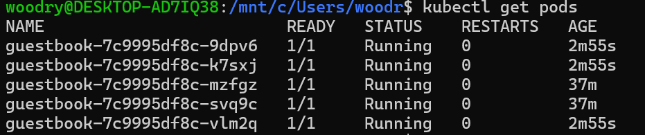
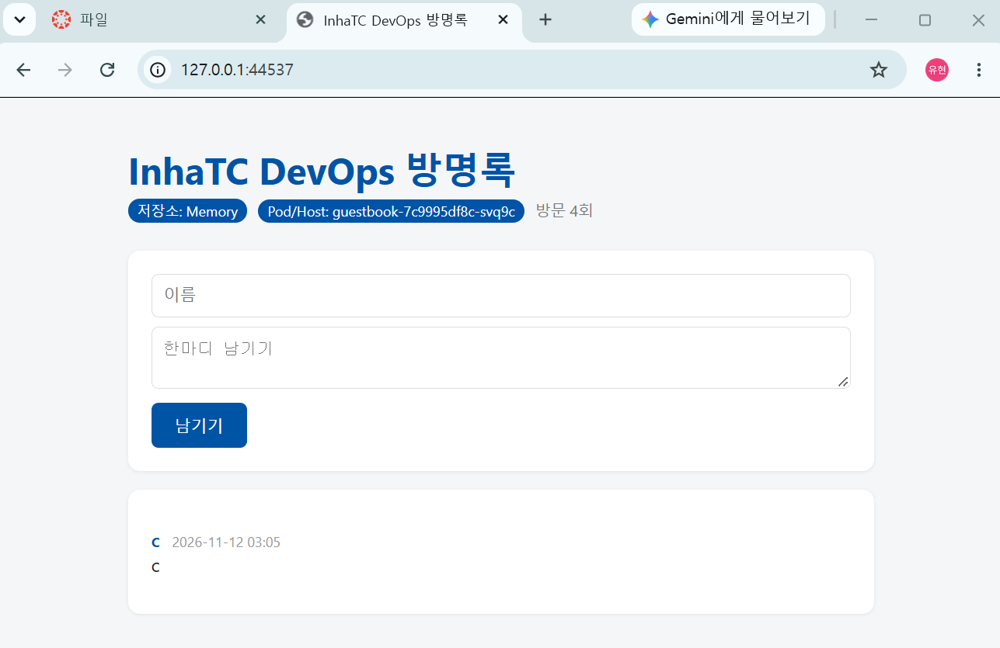
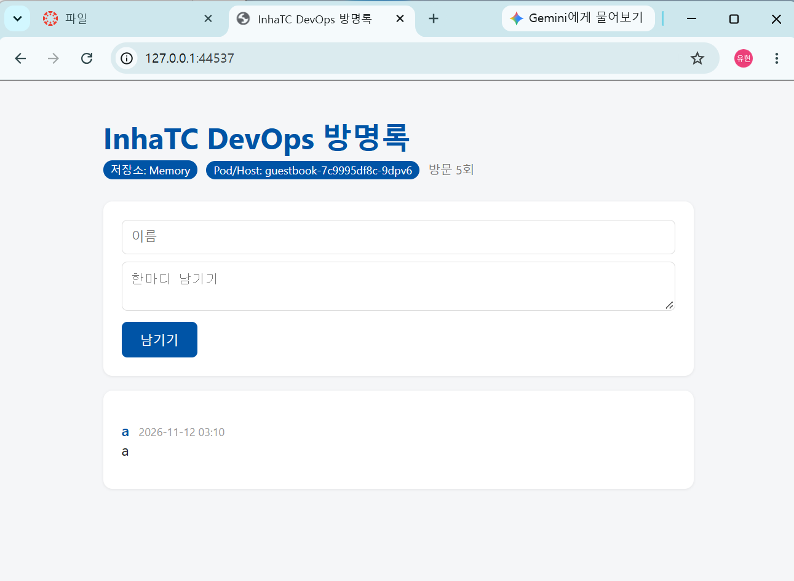
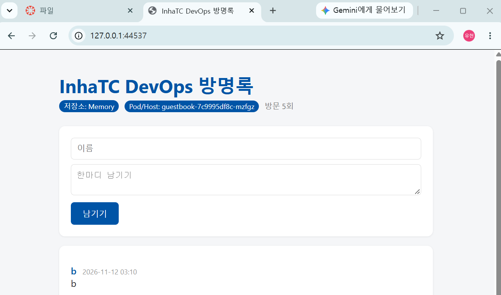
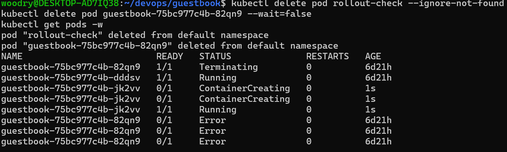
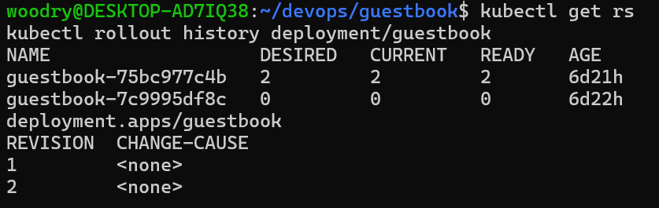
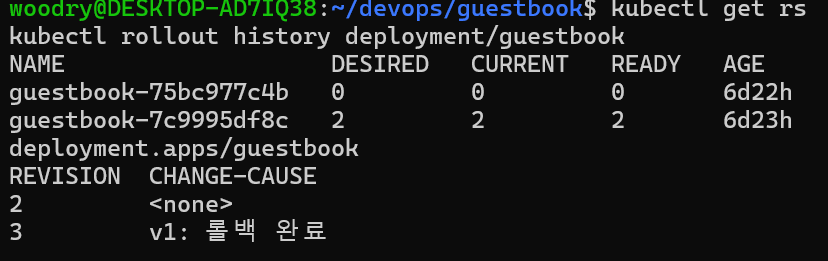
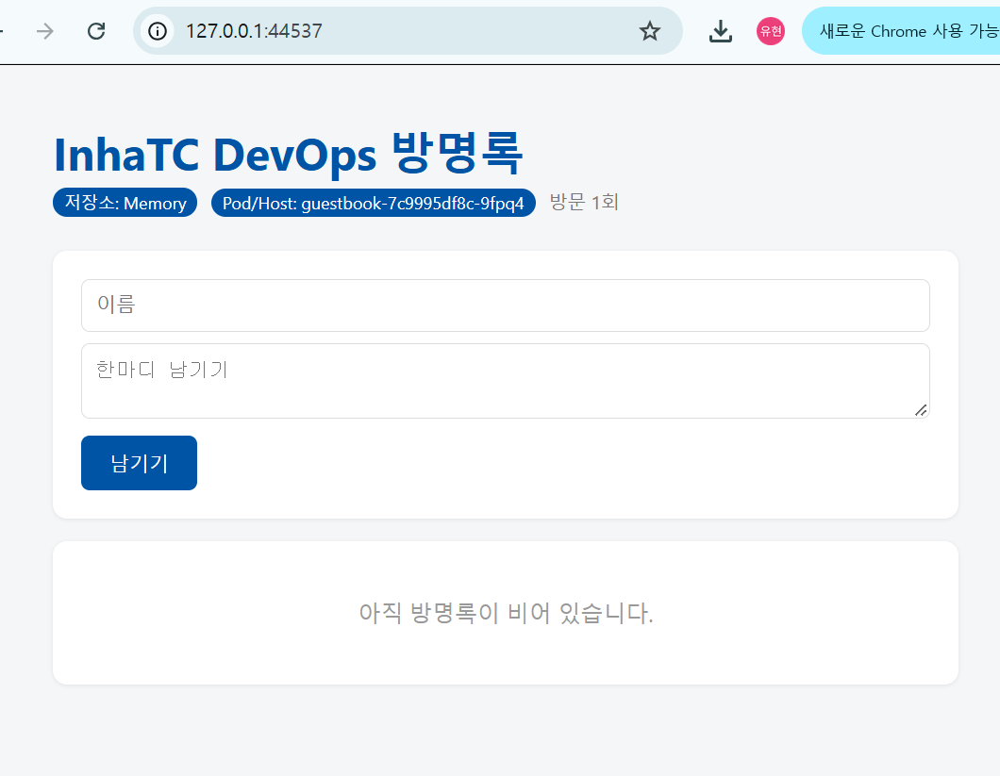

# week10 기록 (Deployment와 Service)

사용한 도구: minikube, kubectl. 매니페스트는 `guestbook/k8s/`의 `deployment.yaml`, `service.yaml`

## 1. YAML로 배포하기
- 지난주 `kubectl create deployment`(명령형)에서 `kubectl apply -f`(선언형)로 바꿈. 원하는 상태를 파일에 적고 클러스터를 그 상태에 맞춤. 파일이라 Git에 기록하고 diff로 변경 이력을 볼 수 있음
- `deployment.yaml`: replicas 2, selector.matchLabels `app: guestbook`, template(Pod 설계도)의 labels `app: guestbook`, image `ghcr.io/hyh326/guestbook:v1`, containerPort 5000
- 레이블이 세 곳에서 일치해야 함: Deployment의 selector.matchLabels = template.labels = Service의 selector. Deployment 쪽이 틀리면 apply가 안 되고, Service 쪽이 틀리면 에러 없이 접속만 안 됨
- `--dry-run=server`로 문법만 리허설한 뒤 `kubectl apply -f k8s/deployment.yaml`로 배포
- `apply`를 다시 실행하면 `unchanged`가 나옴. 몇 번을 해도 같은 결과(멱등성). `create`는 이미 있으면 `AlreadyExists` 에러
- 3층 구조: Deployment(`guestbook`) → ReplicaSet(`guestbook-7c9995df8c`, 자동 생성) → Pod(`guestbook-7c9995df8c-xxxxx`). 내가 만든 건 Deployment뿐이고 나머지는 쿠버네티스가 만듦

## 2. Service (NodePort)
- Pod가 죽고 새로 생기면 IP가 바뀜. 그래서 고정된 이름과 IP를 가진 대표 창구인 Service가 필요함
- `service.yaml`: type NodePort, selector `app: guestbook`, port 80, targetPort 5000, nodePort 30080 (Service의 selector에는 `matchLabels:`가 없음)
- 포트 세 개: nodePort 30080(노드의 바깥 문) → port 80(서비스의 문) → targetPort 5000(컨테이너의 문)
- `kubectl describe svc guestbook`의 `Endpoints: 10.244.0.4:5000,10.244.0.5:5000`은 selector로 찾은 Pod 2개의 IP
- 서비스 이름이 곧 클러스터 안 주소라서 다른 Pod에서 `http://guestbook/`으로 접속됨
- Docker 드라이버라서 `minikube service guestbook`으로 터널을 열고 `http://127.0.0.1:44537`로 접속함(포트는 매번 달라짐). 이 터미널은 열어 둬야 함. 첫 번째 표의 `192.168.49.2:30080`은 클러스터 안쪽 주소라 브라우저에서 안 열림
- 7주차 nginx와 비교: nginx는 컨테이너를 추가하고 `nginx.conf`를 직접 썼는데, Service는 selector와 ports 몇 줄로 끝남

## 3. 스케일링과 로드밸런싱

- `kubectl scale deployment guestbook --replicas=5`로 Pod 5개가 `Running`이 됨. 기존 2개(37m)는 그대로고 새 3개(2m55s)만 만들어짐

| 요청 | 브라우저의 Pod/Host |
|---|---|
| host-1 | guestbook-7c9995df8c-svq9c |
| host-2 | guestbook-7c9995df8c-9dpv6 |
| host-3 | guestbook-7c9995df8c-mzfgz |

- 같은 주소로 접속해도 Pod 이름이 바뀜. 로드밸런서를 따로 설정하지 않았는데도 Service가 selector로 찾은 Pod들에게 요청을 나눠 보내기 때문
- 터미널에서도 확인함: `kubectl run lb-check --rm -i --restart=Never --image=busybox:1.37 -- sh -c 'for ... wget -q -T 3 -O- http://guestbook/healthz'`로 10번 요청하니 5개 Pod(9dpv6, svq9c, vlm2q, mzfgz, k7sxj)가 모두 hostname을 돌려줌
- 글과 방문 횟수가 Pod마다 다름(mzfgz는 방문 2회, svq9c는 4회). 저장소가 Memory라서 Pod마다 따로 저장하기 때문
- 줄이기: `--replicas=2`로 줄이면 나중에 만든 3개가 `Terminating`이 되고 오래된 2개가 남음
- 숫자를 바꾸는 방법 두 가지: `kubectl scale`은 빠르지만 파일에 기록이 안 남음. `deployment.yaml`을 고치고 `apply`하면 기록이 남음. scale 뒤에 apply하면 파일 값으로 되돌아감

## 4. 자가 치유

- Pod `guestbook-75bc977c4b-82qn9`를 삭제하자 `Terminating`이 되는 동시에 새 Pod `jk2vv`가 1초 만에 `Running`이 됨. Pod 개수는 계속 2개
- 조정 루프로 설명됨: 원하는 상태는 2개인데 현재 1개라서(관찰, 비교) 1개를 새로 만듦(조치)
- 새 Pod는 이름 끝이 다름. 되살린 게 아니라 새로 만든 것
- 지워지는 옛 Pod에 `Error`가 잠깐 보이는데 지워지는 Pod의 마지막 상태 표시로 보이고, 정확한 원인은 확인하지 않음

## 5. 롤링 업데이트
- v2 준비: `templates/index.html`의 `{{ title }}`을 `sed`로 `{{ title }} v2`로 바꾸고 `docker build -t ghcr.io/hyh326/guestbook:v2 .`, `docker push`
- 관찰용 터미널을 나눔: 서비스 응답을 1초마다 보내는 `rollout-check` Pod, `kubectl get pods -w`, 배포용 터미널
- 배포: `kubectl set image deployment/guestbook web=ghcr.io/hyh326/guestbook:v2` (`web`은 YAML의 컨테이너 이름), `kubectl rollout status`에서 `successfully rolled out`
- Pod 교체 순서: v2 하나가 `Running`이 됨 → v1 하나가 `Terminating` → v2 하나 더 `Running` → 나머지 v1이 `Terminating`. 중간에도 항상 `Running`인 Pod가 있어서 서비스가 거의 끊기지 않음
- 틀(template)이 바뀌어서 새 ReplicaSet `75bc977c4b`(v2)가 생기고 옛 `7c9995df8c`(v1)는 0개로 남음. Pod 이름 가운데 해시로 버전을 구분함

- `kubectl rollout history`에 REVISION 1(v1), 2(v2)가 보임. 이때 CHANGE-CAUSE는 `<none>`
- `set image`는 파일에 반영이 안 돼서 `deployment.yaml`에는 v1이 남아 있음. 나중에 `apply -f`하면 v1로 돌아가므로 실무에서는 파일을 고치고 Git으로 관리함

## 6. 롤백

- `kubectl rollout undo deployment/guestbook` 후 v1(`7c9995df8c`)이 2개, v2(`75bc977c4b`)가 0개가 됨. 코드를 되돌려 다시 빌드하지 않고, 0개로 남겨 둔 옛 ReplicaSet을 되살린 것
- history가 `1, 2`에서 `2, 3`으로 바뀜. 되돌려도 기록은 지워지지 않고 번호가 새로 쌓임(Git의 revert와 비슷)

- 브라우저의 제목에서 `v2`가 사라졌고 Pod/Host는 `guestbook-7c9995df8c-9fpq4`(v1). 방문 1회에 글이 비어 있는 건 새 Pod의 메모리가 비어서
- `undo` 때 `Warning`이 나옴. `apply`로 관리하던 Deployment는 `undo`가 last-applied 기록을 안 바꾼다는 경고. 롤백한 v1이 `deployment.yaml`과 같아서 문제없음
- `kubectl annotate deployment/guestbook kubernetes.io/change-cause="v1: 롤백 완료"`로 REVISION 3의 CHANGE-CAUSE에 이유를 남김

## 7. 막혔던 것과 해결
- Docker Desktop이 꺼져 있어서 `minikube start`가 `PROVIDER_DOCKER_VERSION_EXIT_1`, WSL에서는 `docker` not found: Docker Desktop을 업데이트하고 `Engine running`이 된 뒤 WSL을 다시 열어서 `docker ps`로 확인
- `minikube service`에 표가 두 개 나옴: 터널 주소(`127.0.0.1:포트`)로 접속해야 하고 터미널을 닫으면 끊김

## 8. 정리 (기말 대비)
- Deployment → ReplicaSet → Pod. 우리는 Deployment만 만들고 나머지는 쿠버네티스가 만듦
- Service는 대표번호. Pod IP가 바뀌어도 이름과 IP는 그대로고 요청을 Pod들에게 나눠 줌
- `apply`는 몇 번을 해도 같은 결과(멱등성). 레이블 세 곳이 일치해야 함
- 롤링 업데이트는 새 ReplicaSet으로 하나씩 교체, 롤백(`rollout undo`)은 이전 ReplicaSet 복원
- 고민거리(다음 시간): YAML에 비밀번호를 쓰고 GitHub에 올리면 공개됨. 글이 나타났다 사라짐(Memory). 앱은 살아 있지만 응답을 못 하는 상태를 쿠버네티스가 어떻게 아는가

## 9. 이론: 왜 굳이 이 도구들을 쓰는가
- 핵심 질문: "그냥 파이썬을 실행하면 안 되나?", "GitHub 웹사이트로 하면 안 되나?" 수업에서 배우는 도구가 배포의 유일한 방법은 아님. 명령어보다 먼저 "왜 필요한가"를 이해해야 함
- 배포란 내 컴퓨터에서 만든 프로그램을 다른 사람이 쓸 수 있게 하는 과정(개발 → 서버에서 실행 → 사용자가 브라우저로 접속). Docker로 실행하는 것이 배포인 게 아니라 사용자가 서비스를 쓰게 하는 것이 배포
- 도커 없이도 서버에서 직접 실행할 수 있음. 다만 서버와 내 노트북의 파이썬 버전이 다르거나, 패키지를 하나 빼먹거나, 서버가 3대면 매번 설정해야 하는 문제가 생김
- 도커 이미지 = 애플리케이션 + 라이브러리 + 실행에 필요한 설정(운영체제 전체는 포함하지 않음). 개발 컴퓨터와 운영 서버에서 같은 이미지로 컨테이너를 실행하니 환경을 일관되게 재현하기 쉬움(단, OS와 CPU 호환성은 따로 고려)

| 도구 | 해결하는 문제 |
|---|---|
| Git / GitHub | 코드를 어떻게 기록하고 공유할까 |
| WSL / 우분투 | 리눅스 개발 환경을 어떻게 준비할까 |
| 도커 / 컴포즈 | 실행 환경과 여러 서비스를 어떻게 관리할까 |
| 쿠버네티스 | 컨테이너 수를 유지하고 서비스를 원하는 상태로 어떻게 유지할까 |

- WSL과 우분투는 다른 기술: WSL은 윈도우에서 리눅스를 실행하는 환경이고, 우분투는 그 안에서 쓰는 리눅스 배포판 중 하나. 우분투가 유일한 정답은 아님
- Git은 코드 변경 이력을 관리하는 도구이고 GitHub는 Git 저장소를 온라인에 보관하고 협업하는 서비스. 둘은 대체 관계가 아님. 웹에서도 파일 수정은 되지만 여러 파일의 개발, 실행, 테스트, 이력 관리는 로컬 작업이 편함
- GUI는 사람이 직접 조작하기에 편하고, CLI는 반복 작업 자동화, 모니터 없는 원격 서버(SSH), 스크립트와 AI 에이전트 연동에 유리함. 무엇이 우월한지가 아니라 상황에 맞게 선택하는 것이 중요
- 컴포즈: 방명록(Flask 웹 서버, Redis, Nginx)처럼 여러 컨테이너, 네트워크, 환경 변수, 볼륨을 `compose.yaml` 하나로 정의함. `docker run`을 일일이 반복하지 않아도 됨
- 쿠버네티스: 컨테이너를 하나 실행하는 것과 서비스가 계속 유지되게 운영하는 것은 다름. 원하는 복제본 수를 유지하고 장애가 나면 재생성을 시도함. 단 모든 장애를 자동으로 해결하거나 무중단을 보장하지는 않음. Pod 복제와 서비스 무중단은 다른 개념
- 도구를 항상 순서대로 써야 하는 것도 필수 단계인 것도 아님. 해결하려는 문제에 따라 도구가 달라짐

| 상황 | 고려할 도구 |
|---|---|
| 혼자 만드는 간단한 웹 실습 | 파이썬 직접 실행 |
| 실행 환경을 다른 PC에서 재현 | 도커 |
| 웹 서버와 Redis를 함께 실행 | 도커 컴포즈 |
| 여러 복제본과 장애 복구 관리 | 쿠버네티스 |

- 작은 프로젝트에서는 쿠버네티스를 쓰지 않는 것이 더 합리적일 수 있음
- 생각해 볼 질문: 상황 A(혼자 만드는 방명록을 서버 한 대에서 실행)는 파이썬 직접 실행이나 도커/컴포즈로 충분하고, 상황 B(방문자가 늘어 여러 서버에서 운영)는 복제본 유지와 장애 복구가 필요해서 쿠버네티스를 고려함. "무엇을 쓸까?"보다 먼저 "어떤 문제가 있을까?"를 생각하는 것이 핵심
- AI 시대에 명령어가 중요한 이유: AI 에이전트는 허용된 명령어와 API로 작업을 수행하는데, Git, 도커, 쿠버네티스는 이미 다양한 명령어를 제공함. 명령어를 이해하면 AI가 수행한 작업을 검토하고 수정하기 쉬움
- 앞으로 풀 문제: CI/CD(코드를 고칠 때마다 테스트와 배포를 직접 해야 하나), GitHub Actions(코드를 올리면 자동으로 확인할 수 있나), 배포 전략(새 버전으로 바꿀 때 서비스를 꼭 중단해야 하나), 로그와 모니터링(문제가 생기면 어떻게 알아낼까)
