# 11주차 - 쿠버네티스 설정과 상태 점검

방명록(guestbook)의 설정을 이미지 밖(ConfigMap, Secret)으로 빼고, Redis를 쿠버네티스 안에 띄워 연결했다. 이어서 liveness/readiness probe를 설정해 일부러 실패시켜 보았고, 문제가 생겼을 때 확인하는 순서(트러블슈팅 3단 루틴)를 정리했다.

- 실습 파일: `guestbook/k8s/`의 `configmap.yaml`, `redis.yaml`, `deployment.yaml`, `secret.yaml.example`
- 실제 `secret.yaml`은 Git에 올리지 않았다. `.gitignore`에 넣었고, 비밀번호를 `CHANGE_ME`로 바꾼 예시 파일만 올렸다.

## 1. 설정을 이미지 밖으로 (ConfigMap, Secret)
- 같은 이미지를 개발, 테스트, 운영에서 쓰고 설정만 바꾸려고 분리한다(Build once, run anywhere). 12-factor의 3번째 원칙(설정은 환경 변수에 저장)과 같은 이야기다.
- ConfigMap `guestbook-config`: `APP_TITLE`, `THEME_COLOR`, `REDIS_HOST`, `REDIS_PORT`
- Secret `guestbook-secret`: `REDIS_PASSWORD` (수업용 더미 비밀번호)
- 값이 숫자이거나 `#`이 들어가면 따옴표로 감싼다. `#16a34a`는 따옴표가 없으면 `#` 뒤가 주석이 되어 값이 사라지고, `6379`는 숫자로 읽혀서 문자열이어야 하는 `data`에서 에러가 난다.
- ConfigMap은 `spec`이 아니라 `data` 아래에 키와 값을 적는다.

## 2. Secret 까보기: 왜 안전하지 않은가
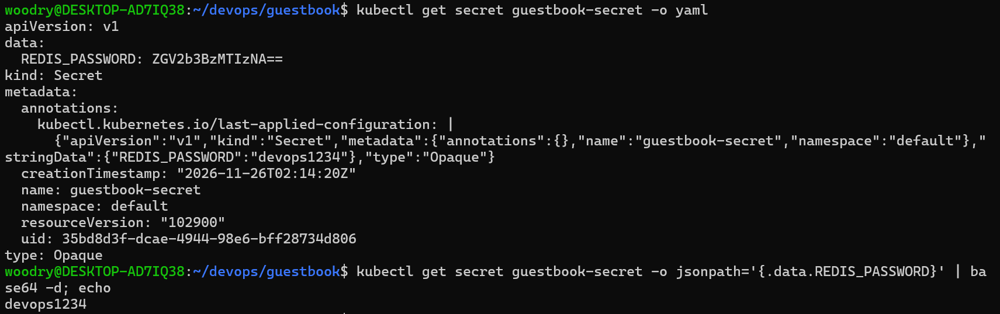

- `kubectl get secret guestbook-secret -o yaml`에서는 `REDIS_PASSWORD: ZGV2b3BzMTIzNA==`로 보이지만, `base64 -d`로 풀면 `devops1234`가 그대로 나온다.
- Secret의 `data`는 암호화가 아니라 base64 인코딩이다. 글자를 다른 표기로 바꿨을 뿐이라 누구나 풀 수 있다.
- 같은 화면의 `annotations`에 있는 `last-applied-configuration`에는 `stringData`의 `devops1234`가 평문 그대로 들어 있었다. `kubectl apply`가 적용한 원본 파일 내용을 저장하기 때문이다. 즉 `base64 -d`를 안 해도 비밀번호가 보이는 곳이 하나 더 있다.

| 구분 | 하는 일 | 해석 | 예 |
|---|---|---|---|
| 인코딩 | 표기 방식 바꾸기 | 누구나 가능 | base64 |
| 암호화 | 열쇠로 잠그기 | 열쇠가 있어야 가능 | HTTPS, 압축 파일 암호 |
| 해시 | 지문 만들기 | 불가능(비교만 가능) | Git 커밋 ID |

- 그래도 Secret을 쓰는 이유: `kubectl get` 화면에 값이 바로 뜨지 않아 실수로 노출되는 것을 막고, 설정과 비밀을 따로 관리할 수 있다.
- 하지만 앱 로그, 환경 변수 출력, `stringData` YAML에는 노출될 수 있다. 실제 서비스에서는 접근 권한 관리, 저장 시 암호화, 외부 비밀 관리 도구를 함께 쓴다.
- 그래서 `secret.yaml`은 `.gitignore`로 제외하고 `secret.yaml.example`(비밀번호는 `CHANGE_ME`)만 올렸다. 비밀번호를 공개 저장소에 올리면 봇이 찾아서 악용할 수 있다.

## 3. Redis 배포와 설정 주입
- `redis.yaml`: Redis Deployment(`redis:7-alpine`)와 Service. 파일 하나에 오브젝트 두 개를 넣을 때는 `---`로 구분해야 한다. Service는 `ClusterIP`라 클러스터 안에서만 접근되고, 서비스 이름 `redis`가 DNS 이름이 되어 ConfigMap의 `REDIS_HOST: "redis"`와 이어진다.
- 설정을 넣는 방법은 두 가지다.

| 구분 | envFrom | env + valueFrom |
|---|---|---|
| 넣는 것 | ConfigMap/Secret의 모든 항목 | 지정한 항목 하나 |
| 환경 변수 이름 | 키 이름 그대로 | `name:`으로 새로 정할 수 있음 |
| 이번 실습에서 | 방명록(`deployment.yaml`) | Redis(`redis.yaml`) |

- `deployment.yaml`에는 `envFrom`(ConfigMap, Secret)과 `resources`(requests 64Mi/100m, limits 128Mi/500m)를 추가했다.
- requests는 스케줄러가 노드를 고를 때 보는 필요량이고, limits를 넘으면 메모리는 OOM kill, CPU는 죽지 않고 느려진다(throttling).

## 4. 연결 확인과 ConfigMap만 바꾸기
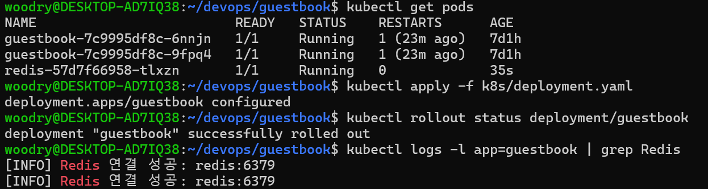

- `kubectl logs -l app=guestbook | grep Redis`에서 `[INFO] Redis 연결 성공: redis:6379`가 파드 수만큼 나왔다.
- 환경 변수 주입 확인: `kubectl exec deploy/guestbook -- printenv APP_TITLE THEME_COLOR REDIS_HOST`

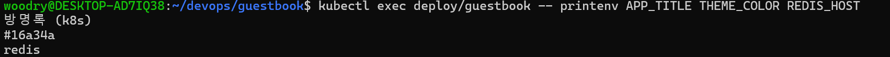

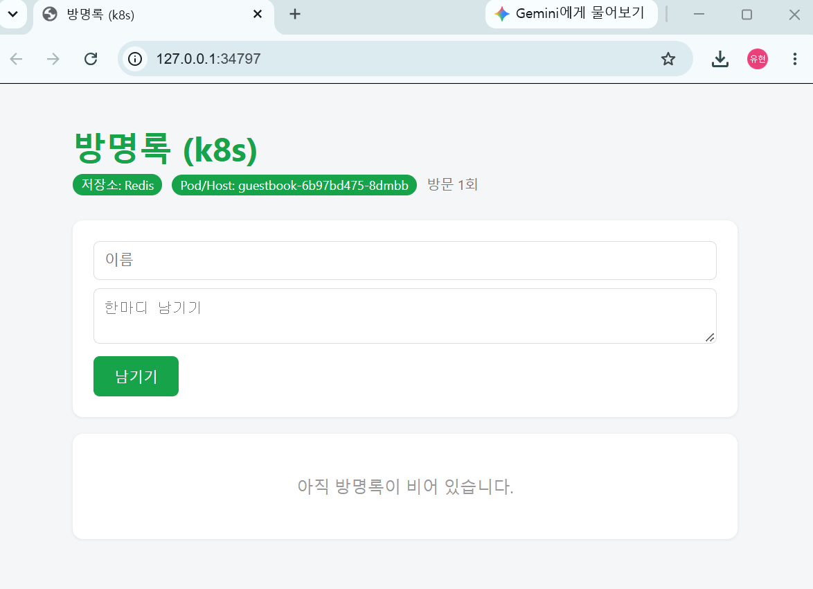

- 글을 남기고 새로고침해서 `Pod/Host`가 바뀌어도 글이 남아 있었다. 파드가 서로 다른 Redis가 아니라 같은 Redis를 쓰기 때문이다.

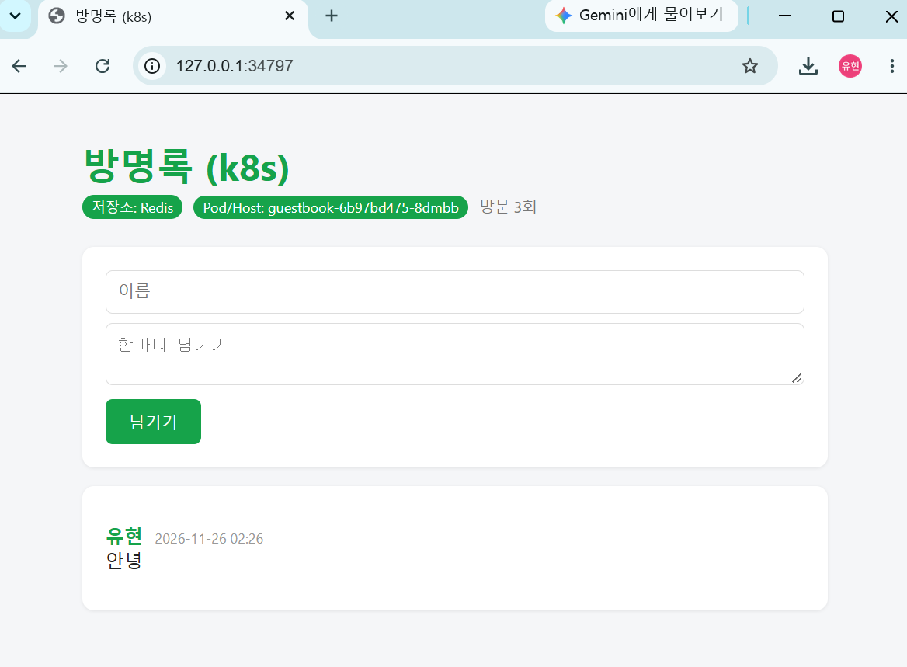

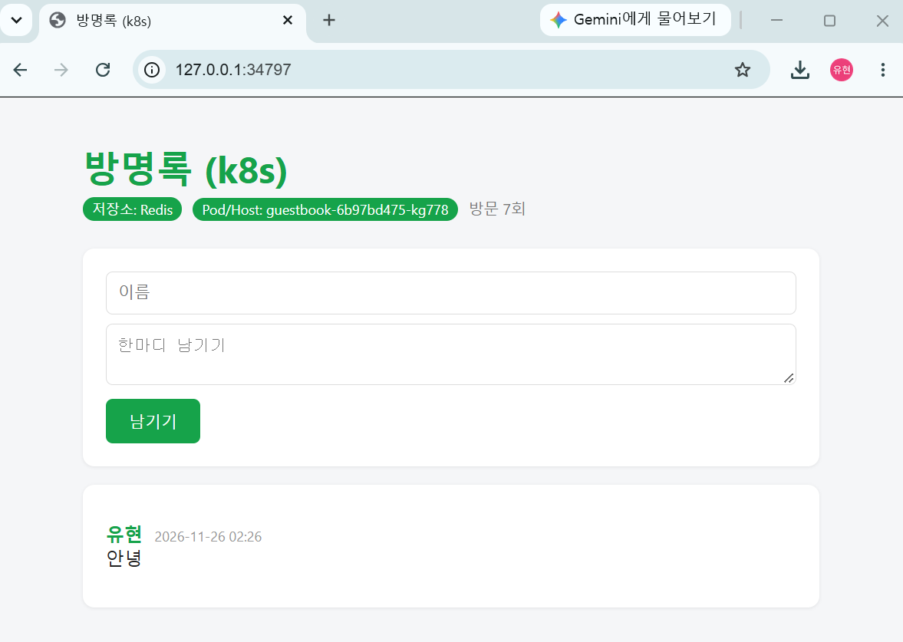

- `kubectl scale deployment guestbook --replicas=4`로 4개로 늘려도 글이 사라지지 않았다. 앱은 상태를 갖지 않고(무상태), 데이터는 Redis에 있기 때문이다.

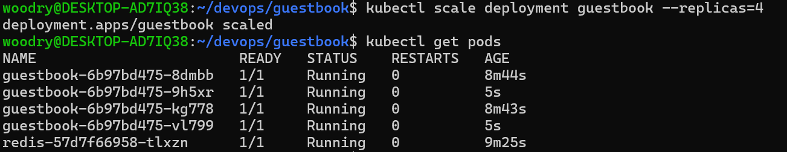

### ConfigMap만 바꾸기
- `kubectl edit configmap guestbook-config`로 `APP_TITLE`을 `"New 방명록 (k8s)"`, `THEME_COLOR`를 `"#e11d48"`로 바꾸고 `kubectl rollout restart deployment guestbook`을 실행했다.

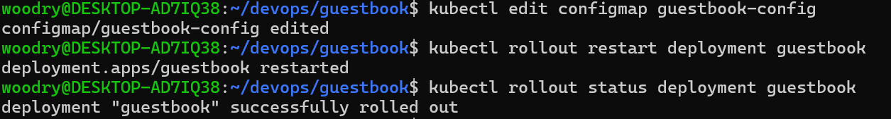

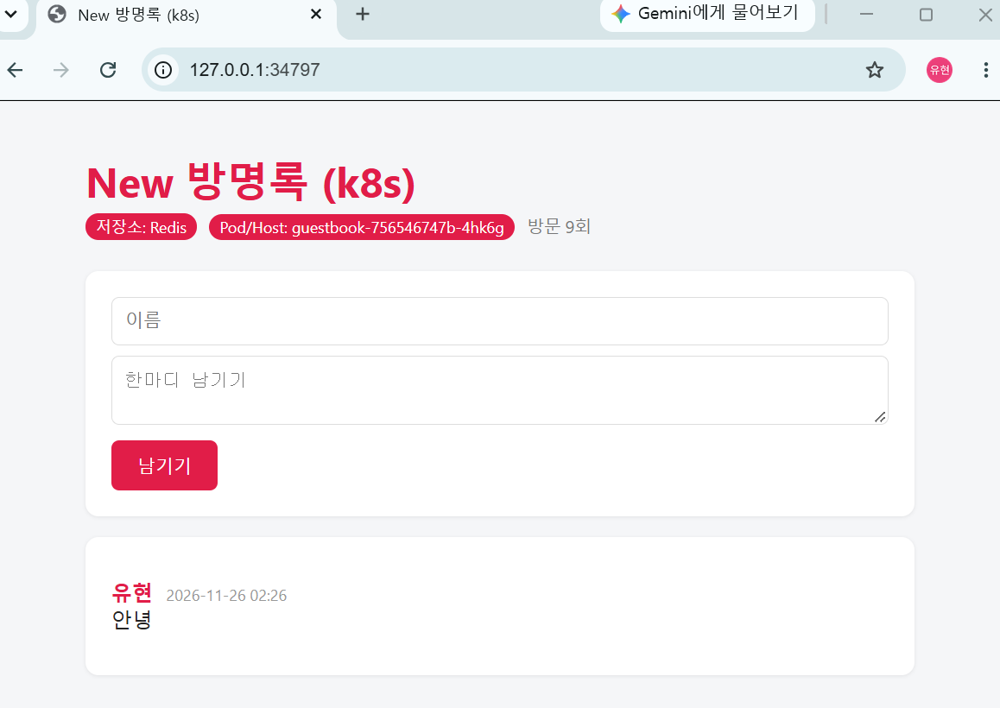

- 이미지를 다시 빌드하지 않았고, 코드도 고치지 않았고, 방명록 글도 사라지지 않았다. 같은 이미지에 다른 ConfigMap만 줘도 동작이 바뀐다.
- restart가 필요한 이유: 환경 변수는 프로세스가 시작할 때 정해진다. ConfigMap을 고쳐도 이미 떠 있는 파드는 모르기 때문에 새 파드를 띄워서 새 값을 읽게 해야 한다.
- 주의: `kubectl edit`로 바꾼 내용은 로컬 YAML과 Git에 자동으로 반영되지 않는다. 그래서 `configmap.yaml`은 처음 값 그대로이고, 팀 프로젝트에서는 파일 수정, apply, Git 순서로 관리해야 한다.

## 5. 헬스체크: liveness와 readiness
- 프로세스가 살아 있는 것과 서비스를 제공할 수 있는 것은 다르다. 앱이 멈추거나 DB 연결이 끊겨도 프로세스는 살아 있어서 쿠버네티스는 정상으로 본다. 그래서 주기적으로 "괜찮니?"를 물어보는 probe를 쓴다.
- 앱에는 이미 응답 통로가 있다. `/healthz`는 항상 200이고, `/readyz`는 Redis가 안 되면 503이다.

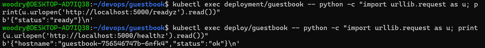

| 구분 | livenessProbe | readinessProbe |
|---|---|---|
| 질문 | 살아 있니? | 요청 받을 준비가 됐니? |
| 우리 앱의 검사 주소 | `/healthz` | `/readyz` |
| 실패하면 | 컨테이너를 죽이고 재시작 | Service에서 트래픽을 끊음(재시작 안 함) |

- 설정값: `initialDelaySeconds`(시작 후 첫 검사까지 대기), `periodSeconds`(검사 간격), `failureThreshold`(연속 몇 번 실패해야 실패로 볼지). 성공은 응답 코드 200~399다.

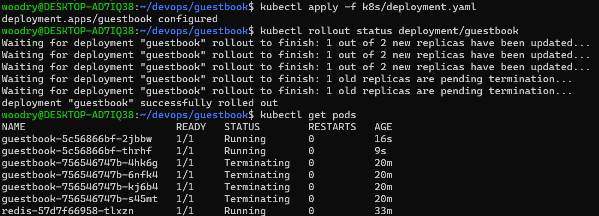

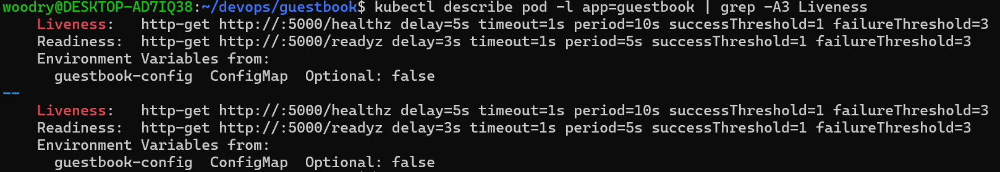

## 6. readiness 실패 실험
- `kubectl scale deployment redis --replicas=0`으로 Redis를 없앴다.

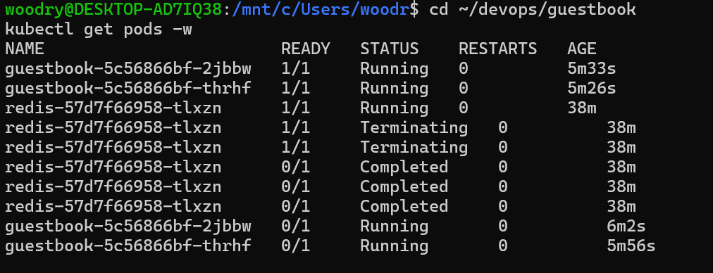

- 15~20초 뒤 guestbook 파드가 `Running`인데 `READY 0/1`이 되었다. 앱은 살아 있지만 요청을 받을 준비가 안 된 상태다. `RESTARTS`는 0으로 그대로라서 재시작은 하지 않는다.

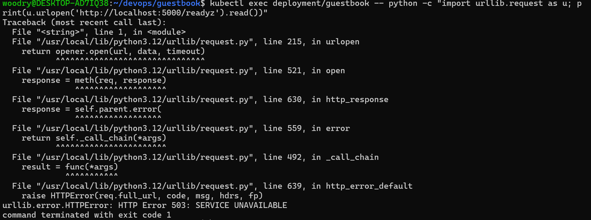

- `/readyz`를 직접 호출하면 `HTTP Error 503: SERVICE UNAVAILABLE`가 나왔다.

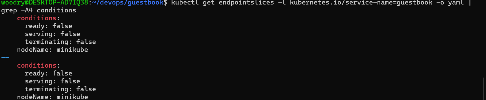

- endpointslices에서 두 파드 모두 `ready: false`였다. Service가 준비 안 된 파드를 명단에서 뺀 것이다.
- `kubectl scale deployment redis --replicas=1`로 되살리자 자동으로 `READY 1/1`로 돌아왔다.

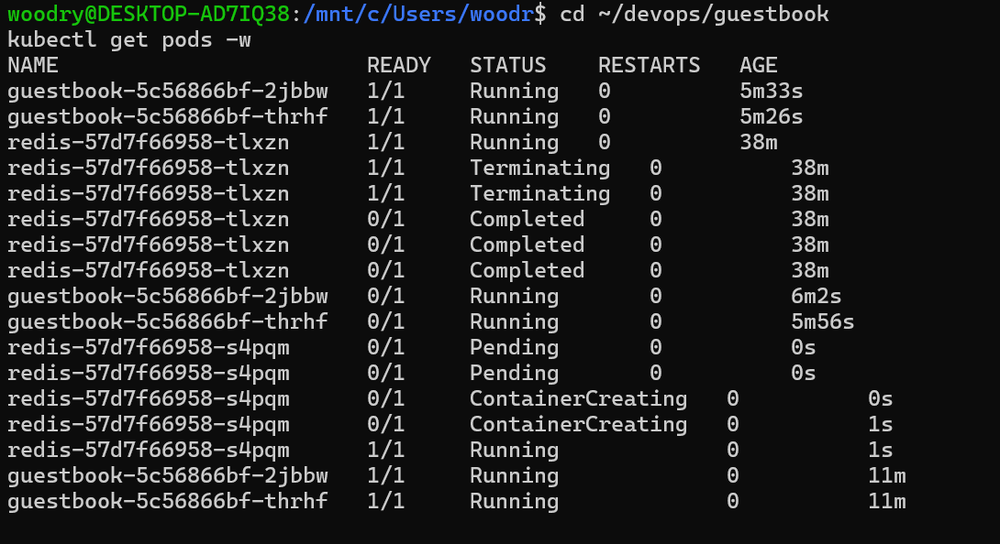

- 복구 뒤 방명록 글이 사라지고 방문 횟수가 1회로 초기화되었다. Redis에 볼륨을 붙이지 않아서 데이터가 파드 안에만 있었기 때문이다. 파드가 새로 뜨면 데이터도 비는 것이 정상이다.

## 7. liveness 실패 실험
- `kubectl patch deployment guestbook --patch-file`로 liveness 경로를 일부러 없는 주소 `/devops`로 바꿨다(`periodSeconds: 5`, `failureThreshold: 2`). 교안은 `-p`로 JSON을 한 줄에 넣는데, 길어서 붙여넣다 끊길 수 있어서 파일로 만들어 적용했다. 결과는 같다.

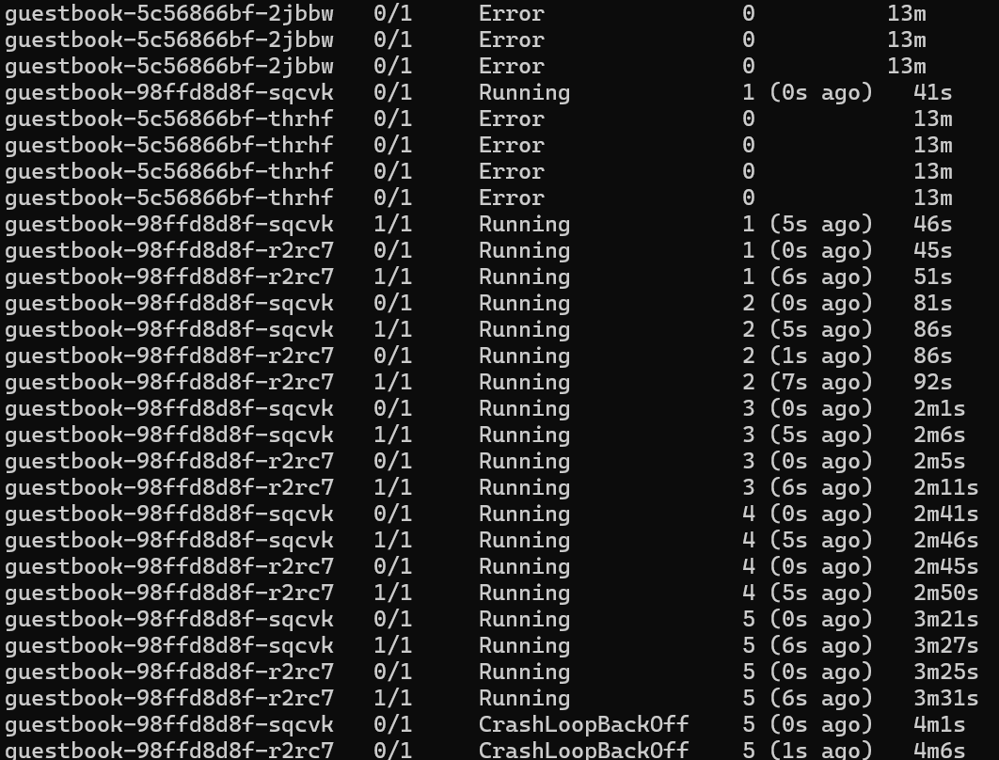

- `RESTARTS`가 1, 2, 3, 4, 5로 계속 올라가다가 `CrashLoopBackOff`가 되었다. 앱은 멀쩡한데 probe 경로 하나 때문에 계속 재시작된 것이다.

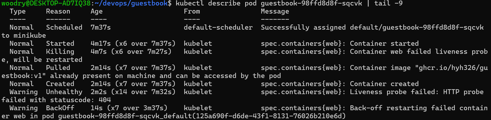

- Events에는 `Liveness probe failed: HTTP probe failed with statuscode: 404`(Unhealthy), `Container web failed liveness probe, will be restarted`(Killing), `Back-off restarting failed container`(BackOff)가 찍혀 있었다.
- 교훈: probe 경로나 포트를 잘못 쓰면 멀쩡한 앱도 계속 재시작된다.
- 원복은 `kubectl apply -f k8s/deployment.yaml`이다. `patch`는 실행 중인 리소스만 바꾸고 파일은 안 바꾸기 때문에 파일 기준으로 다시 적용하면 되돌아간다.

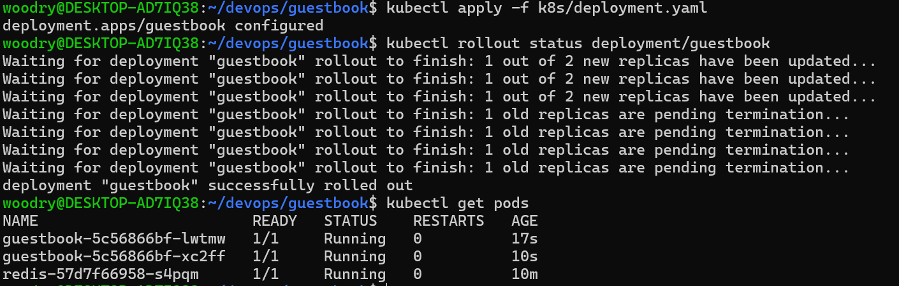

## 8. 트러블슈팅 3단 루틴
문제가 생기면 순서대로 증거를 모은다.
1. `kubectl get pods`: STATUS, READY, RESTARTS로 어떤 상태인지 본다. (이번에는 `0/1`, `RESTARTS 5`, `CrashLoopBackOff`로 이상한 것을 알았다.)
2. `kubectl describe pod <이름>`: 맨 아래 Events를 본다. 대부분의 원인이 여기에 있다. (이번에는 `Liveness probe failed ... 404`가 정답이었다.)
3. `kubectl logs <이름>`: 앱 자체의 에러 메시지를 본다. 계속 재시작되는 파드는 `--previous`로 재시작 전 로그를 본다.

- 이번 실험에서 알게 된 것: `kubectl describe pod -l app=guestbook`처럼 라벨로 한꺼번에 보면 Events가 안 나올 때가 있어서, 파드 이름을 지정해서 봐야 했다.
- 증상별로 보면 `Running 0/1`은 readiness 실패, `RESTARTS` 증가는 liveness 실패나 앱 오류, `CrashLoopBackOff`는 켜자마자 죽는 상태(`logs --previous`), `CreateContainerConfigError`는 ConfigMap/Secret 이름 오타(`describe`의 Events)다.
- AI에게 물어볼 때는 `describe`나 `logs` 결과를 붙여 넣되 Secret 값이나 비밀번호는 지운다(`printenv` 통째로 붙여넣기 금지). 무엇을 붙여 넣을지 아는 것이 먼저이고, 답이 맞는지 `get pods`로 다시 확인하는 것은 내 몫이다.

## 9. 막혔던 것과 해결
- 긴 명령을 붙여넣었더니 `-o`에서 줄이 끊겨 `error: flag needs an argument: 'o' in -o`가 났다. 명령이 두 줄로 쪼개져 실행된 것이다. 해결: 줄을 짧게 하거나 직접 입력했다.
- `kubectl describe pod -l app=guestbook | grep "Liveness probe failed"`가 아무것도 안 나왔다. 해결: 파드 이름을 지정해 `kubectl describe pod <이름> | tail -9`로 보니 Events에 나왔다.
- 윈도우를 재부팅하니 Docker Desktop과 minikube가 꺼져 있었다. 해결: Docker Desktop의 Engine running을 확인하고 `minikube start` 후 `kubectl config use-context minikube`로 컨텍스트를 맞췄다.

## 10. 정리 (기말 대비)
- 설정을 분리하는 이유: 이미지는 하나로 두고 환경마다 설정만 바꾸기 위해서다(Build once, run anywhere).
- Secret은 암호화가 아니라 base64 인코딩이다. `base64 -d`로 누구나 풀 수 있어서 `stringData` YAML과 `kubectl apply`의 어노테이션에도 평문이 남는다. 그래서 `secret.yaml`은 Git에 올리지 않는다.
- `envFrom`은 ConfigMap/Secret의 모든 항목을 환경 변수로 넣고, `env.valueFrom`은 항목 하나를 골라 이름을 정해서 넣는다.
- 환경 변수는 프로세스 시작 시 정해지므로 ConfigMap을 고친 뒤에는 `rollout restart`가 필요하다. `kubectl edit`와 `patch`는 Git과 파일에 반영되지 않는다.
- 앱은 상태를 갖지 않게(무상태) 두고 설정은 ConfigMap/Secret, 데이터는 Redis에 둔다. 그래서 파드를 늘려도 글이 이어진다. 단 Redis에 볼륨이 없으면 Redis 파드가 새로 뜰 때 데이터가 사라진다.
- requests는 스케줄링 기준이고, limits 초과 시 메모리는 OOM kill, CPU는 throttling이다.
- liveness 실패는 컨테이너 재시작(`RESTARTS` 증가), readiness 실패는 Service에서 제외(`READY 0/1`, 재시작 없음)다.
- 트러블슈팅은 `get pods`, `describe`의 Events, `logs`(`--previous`) 순서로 한다.
